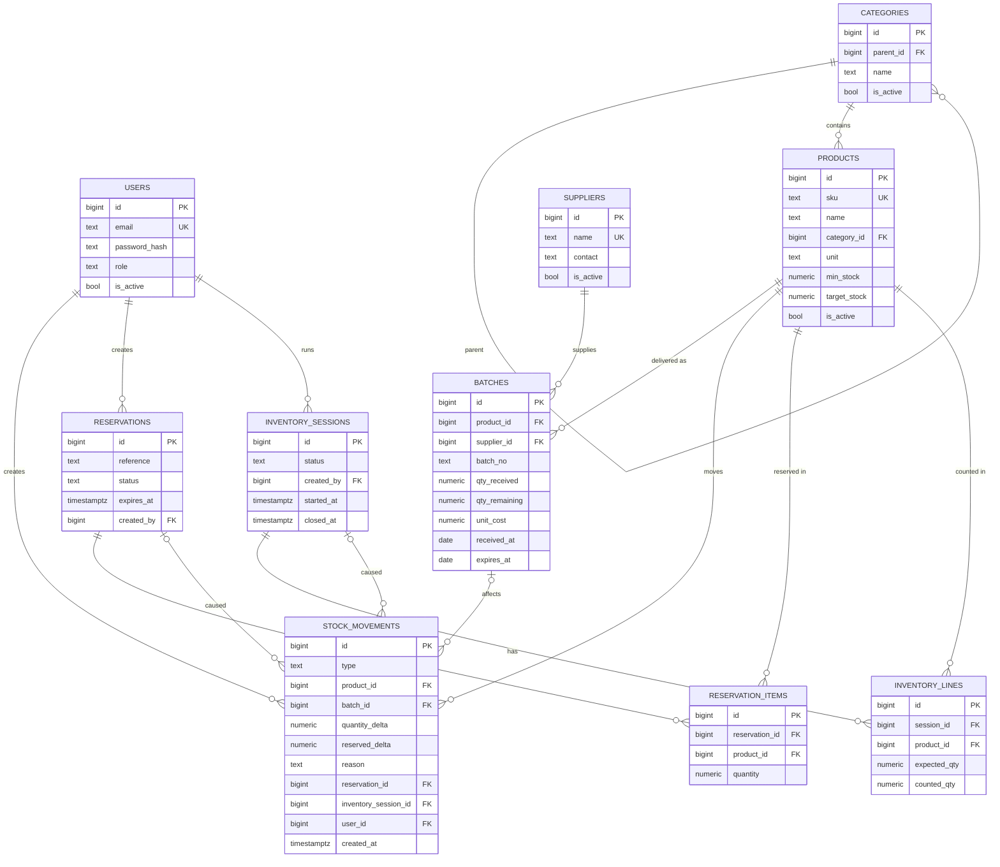

# Схема базы данных (PostgreSQL 16)

Целевая схема. Источник истины после спринта 1 — миграции Alembic (`backend/migrations`); при расхождении правьте этот файл.
Имена таблиц — snake_case, во множественном числе. У всех таблиц `id BIGINT GENERATED ALWAYS AS IDENTITY`, `created_at TIMESTAMPTZ DEFAULT now()`.

## ER-диаграмма


## Таблицы

### users
| Колонка | Тип | Ограничения |
|---|---|---|
| email | text | NOT NULL, UNIQUE (хранить в lower-case) |
| password_hash | text | NOT NULL (argon2/bcrypt, **никогда** не пароль) |
| role | text | NOT NULL, CHECK IN ('admin','storekeeper','viewer') |
| is_active | bool | NOT NULL DEFAULT true |

### categories
`parent_id` → `categories.id` (NULL = корень), `name` NOT NULL, UNIQUE `(parent_id, name)` (для корня — частичный уникальный индекс `WHERE parent_id IS NULL`), `is_active`.
Запретить циклы (категория не может быть своим предком) — проверка в сервисе.

### products
| Колонка | Тип | Ограничения |
|---|---|---|
| sku | text | NOT NULL, UNIQUE, индекс |
| name | text | NOT NULL, индекс для поиска (`pg_trgm` — по желанию) |
| category_id | bigint | NOT NULL, FK → categories |
| unit | text | NOT NULL, CHECK IN ('pcs','kg','l','m','box') |
| min_stock | numeric(14,3) | NOT NULL DEFAULT 0, CHECK >= 0 |
| target_stock | numeric(14,3) | NULL, CHECK (target_stock IS NULL OR target_stock >= min_stock) |
| is_active | bool | NOT NULL DEFAULT true |

### suppliers
`name` NOT NULL UNIQUE, `contact` (телефон/почта, свободный текст), `is_active`.

### batches
| Колонка | Тип | Ограничения |
|---|---|---|
| product_id | bigint | NOT NULL, FK → products |
| supplier_id | bigint | NULL, FK → suppliers (NULL для корректирующих партий инвентаризации) |
| batch_no | text | NOT NULL, UNIQUE `(product_id, batch_no)` |
| qty_received | numeric(14,3) | NOT NULL, CHECK > 0 |
| qty_remaining | numeric(14,3) | NOT NULL, CHECK `>= 0 AND <= qty_received` |
| unit_cost | numeric(14,2) | NOT NULL, CHECK >= 0 |
| received_at | date | NOT NULL |
| expires_at | date | NULL, CHECK `expires_at IS NULL OR expires_at >= received_at` |

Индексы: `(product_id, expires_at NULLS LAST, received_at, id)` — под выборку FEFO; `(expires_at)` — под отчёт «истекают».

### stock_movements (журнал, append-only)
| Колонка | Тип | Ограничения |
|---|---|---|
| type | text | NOT NULL, CHECK IN ('RECEIPT','WRITE_OFF','RESERVE','RELEASE','ADJUSTMENT') |
| product_id | bigint | NOT NULL, FK |
| batch_id | bigint | NULL, FK → batches |
| quantity_delta | numeric(14,3) | NOT NULL DEFAULT 0 |
| reserved_delta | numeric(14,3) | NOT NULL DEFAULT 0 |
| reason | text | NULL: для WRITE_OFF — 'SALE','DAMAGE','EXPIRED','OTHER' |
| reservation_id | bigint | NULL, FK → reservations |
| inventory_session_id | bigint | NULL, FK → inventory_sessions |
| user_id | bigint | NOT NULL, FK → users |
| comment | text | NULL |

Составной CHECK по типу (см. таблицу в [DOMAIN.md](DOMAIN.md#типы-движений)):
```
(type='RECEIPT'    AND quantity_delta > 0 AND reserved_delta = 0 AND batch_id IS NOT NULL) OR
(type='WRITE_OFF'  AND quantity_delta < 0 AND reserved_delta = 0 AND batch_id IS NOT NULL) OR
(type='RESERVE'    AND quantity_delta = 0 AND reserved_delta > 0 AND batch_id IS NULL)     OR
(type='RELEASE'    AND quantity_delta = 0 AND reserved_delta < 0 AND batch_id IS NULL)     OR
(type='ADJUSTMENT' AND quantity_delta <> 0 AND reserved_delta = 0 AND batch_id IS NOT NULL)
```
Индексы: `(product_id, created_at DESC)` — история товара; `(created_at)`; `(batch_id)`.
Append-only: в коде нет UPDATE/DELETE; опционально триггер, запрещающий их на уровне БД.

### reservations / reservation_items
`reservations`: `reference` (номер заказа, NOT NULL), `status` CHECK IN ('ACTIVE','FULFILLED','CANCELLED','EXPIRED'), `expires_at` NOT NULL, `created_by` FK.
Индекс `(status, expires_at)` — под задачу истечения.
`reservation_items`: UNIQUE `(reservation_id, product_id)`, `quantity` CHECK > 0.

### inventory_sessions / inventory_lines
`inventory_sessions`: `status` CHECK IN ('DRAFT','IN_PROGRESS','CLOSED','CANCELLED'), `started_at`, `closed_at`, `created_by`.
`inventory_lines`: UNIQUE `(session_id, product_id)`, `expected_qty` NOT NULL после старта, `counted_qty` NULL пока не введён, CHECK `counted_qty IS NULL OR counted_qty >= 0`.
Ограничение «один товар — не более чем в одной открытой сессии» проверяется в сервисе (с блокировкой товара).

## Инварианты (на них написать тесты)
1. Для каждого товара: `SUM(batches.qty_remaining) = SUM(stock_movements.quantity_delta)`.
2. Для каждой партии: `qty_remaining = SUM(quantity_delta)` по движениям этой партии.
3. `reserved ≥ 0` и `reserved = SUM(reservation_items.quantity) по ACTIVE-резервам` этого товара.
4. `available = on_hand − reserved` может быть `< 0` только после инвентаризационной корректировки (см. DOMAIN, п. 4).
5. Журнал не меняется: число записей только растёт.

## Миграции
Одна миграция — одно логическое изменение, с рабочим `downgrade`. Автогенерацию Alembic (`--autogenerate`) **всегда просматривайте глазами**:
CHECK-ограничения и частичные индексы она часто теряет — дописывайте вручную.
