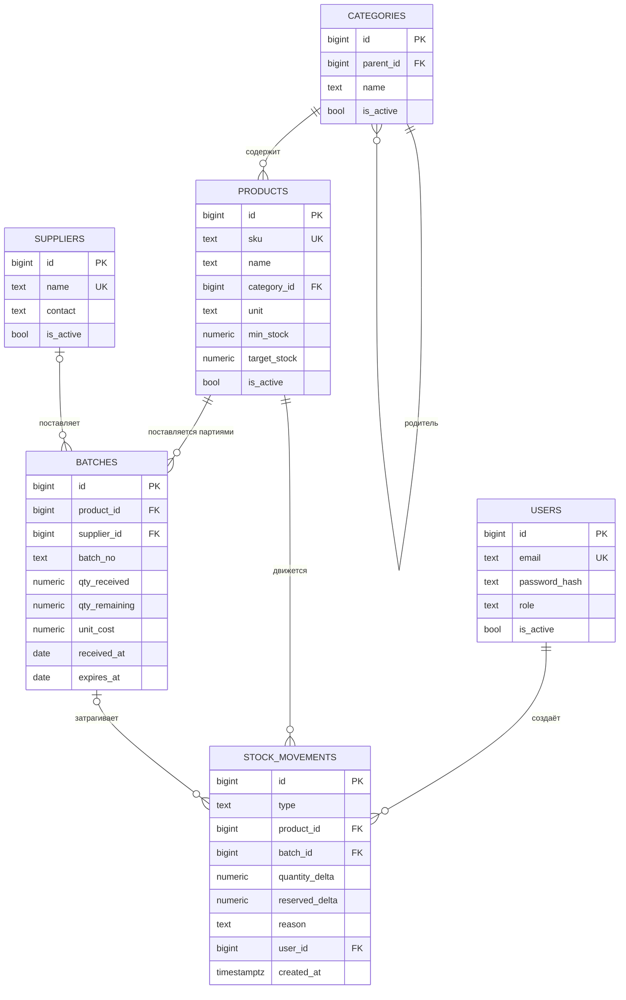

# ER-модель базы данных

Диаграмма сущностей, которые создаёт первая миграция (спринт 1): пользователи, категории, товары, поставщики, партии и журнал движений.
Резервы и инвентаризация добавятся в спринте 3; полная целевая схема — в [DB_SCHEMA.md](DB_SCHEMA.md).

## Связи
| Связь | Кратность | Комментарий |
|---|---|---|
| категория → категория | 1 : N | дерево; корневая категория без родителя |
| категория → товары | 1 : N | у товара ровно одна категория |
| товар → партии | 1 : N | каждый приход создаёт партию |
| поставщик → партии | 1 : N | у корректирующих партий инвентаризации поставщика нет |
| товар → движения | 1 : N | журнал по товару |
| партия → движения | 1 : N | приход, списания и корректировки по партии |
| пользователь → движения | 1 : N | кто выполнил операцию |

## Ограничения
- `users.email` и `products.sku` уникальны; `suppliers.name` уникально.
- Название категории уникально в пределах родителя.
- `users.role` — одно из `admin`, `storekeeper`, `viewer`.
- `products.unit` — одно из `pcs`, `kg`, `l`, `m`, `box`; `min_stock >= 0`; `target_stock` не меньше `min_stock`.
- Партия: `qty_received > 0`, `0 <= qty_remaining <= qty_received`, `unit_cost >= 0`, срок годности не раньше даты прихода; пара `(product_id, batch_no)` уникальна.
- Журнал движений: тип жёстко связан со знаком количества и наличием партии (приход всегда `+`, списание всегда `−`, резерв не меняет `quantity_delta`). Записи не изменяются и не удаляются.
- Количества — `NUMERIC(14,3)`, деньги — `NUMERIC(14,2)`; `float` не используем.
